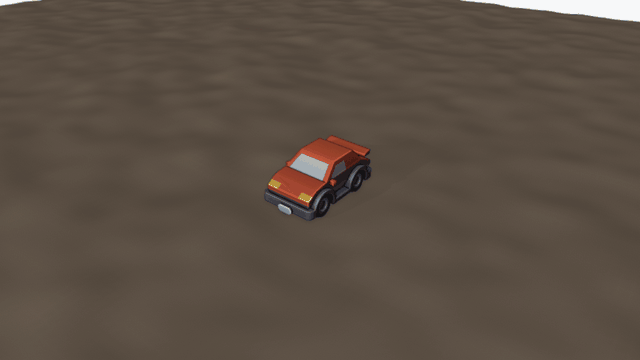
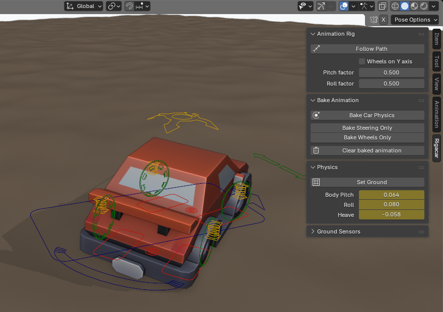
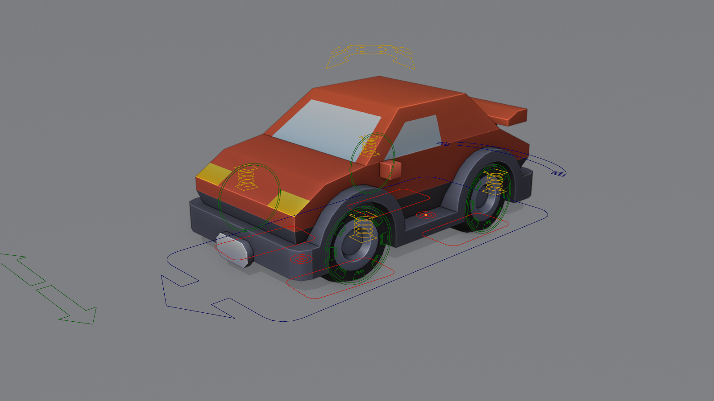
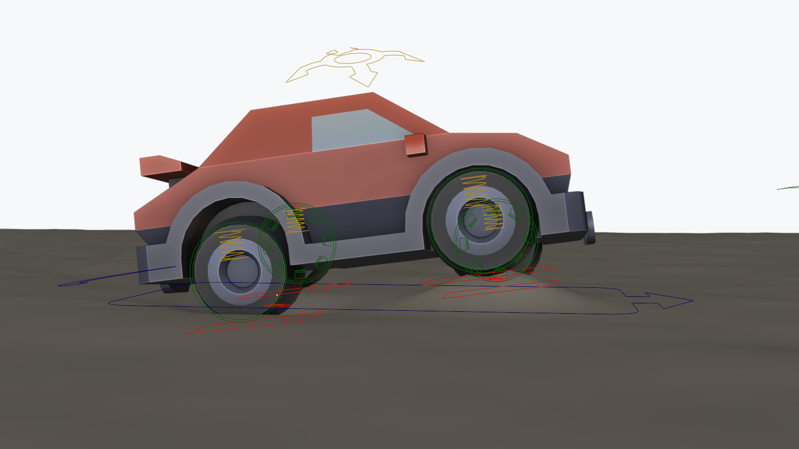
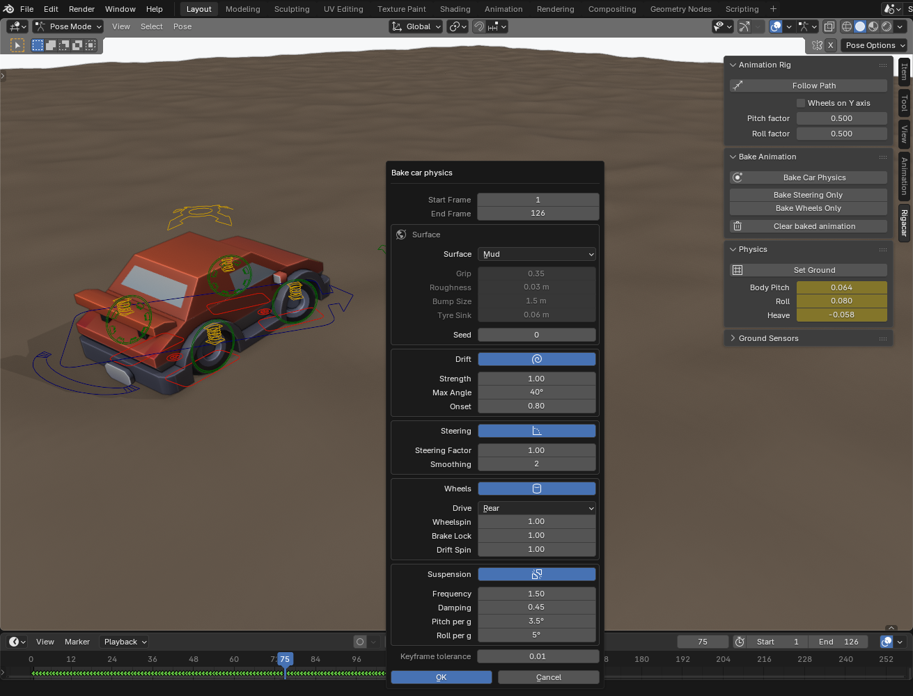
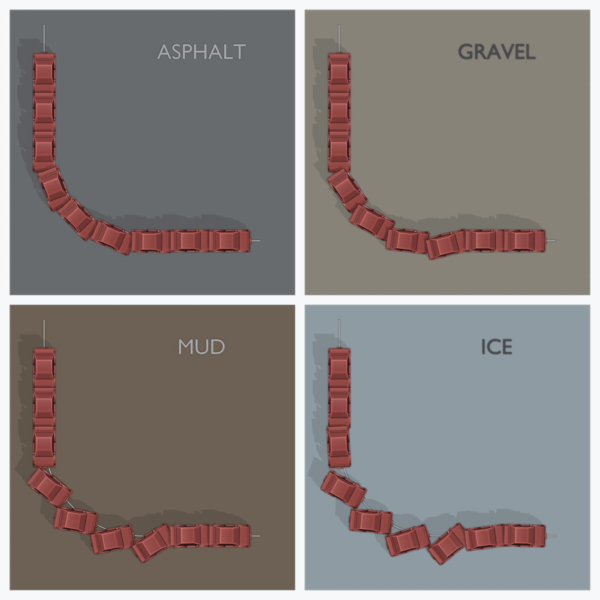
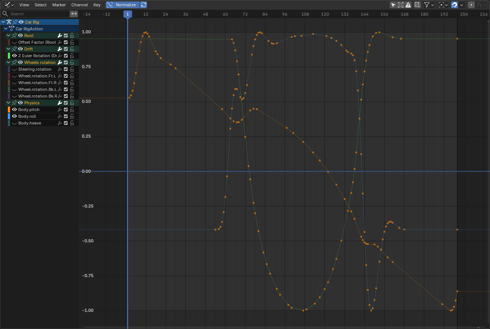

# Rigacar

**Car rigs for Blender in seconds, now with physics.** Rigacar builds a complete animation rig from your car model, then animates
the wheels, the steering, drifts and the suspension for you, on any surface from dry asphalt to mud and ice.



*Everything in this animation is baked by Rigacar: the car follows a curve, and the physics bake adds the slide out of the bend, the
counter-steer, the spinning rear wheels, the body rolling and pitching on its springs, and the wheels riding the bumps.*

| Blender | Status |
|---|---|
| **5.2 LTS** | ✅ Supported. Every feature tested: 134 end-to-end checks, a background suite and 23 unit tests |
| 4.2 – 5.1, including 4.5 LTS | Should work. Installs as an extension; rigging and baking were tested by the [webbertakken fork](https://github.com/webbertakken/rigacar), the physics only on 5.2 so far |
| 4.0 – 4.1 | Should work, installed as a legacy add-on; untested by this fork |
| 3.x and older | Use [upstream Rigacar 7.1](https://github.com/digicreatures/rigacar) |

---

## Contents

- [What's new in 9.0](#whats-new-in-90)
- [Install](#install)
- [Quick start](#quick-start)
- [Preparing a car model](#preparing-a-car-model)
- [The rig and its controls](#the-rig-and-its-controls)
- [Driving the car](#driving-the-car)
- [Bumpy roads and terrain](#bumpy-roads-and-terrain)
- [Car physics](#car-physics)
- [Baked channels](#baked-channels)
- [Scripting and render farms](#scripting-and-render-farms)
- [Troubleshooting](#troubleshooting)
- [Development and tests](#development-and-tests)
- [Changelog](#changelog)
- [Credits and licence](#credits-and-licence)

---

## What's new in 9.0

This fork brings Rigacar up to Blender 5.2 and turns its wheel baker into a physics bake.

- **Blender 5.2 support.** Built on the [webbertakken fork](https://github.com/webbertakken/rigacar)'s Blender 4 and 5 port,
  with the Blender 5.2 fixes on top. It installs as a Blender extension (`blender_manifest.toml`) and still as a legacy add-on.
- **Bake Car Physics.** One button bakes drift, steering, wheel spin and slip, rough-ground bumps and a sprung body, for a chosen
  surface: asphalt, wet asphalt, gravel, dirt, mud, sand, snow or ice.
- **Drifting.** The rear slides out of corners taken faster than the surface's grip allows, then swings back. The front wheels
  counter-steer on their own.
- **Suspension dynamics.** The body squats when accelerating, dives when braking, leans out of corners and bounces over bumps,
  with a spring stiffness and damping you choose.
- **Mud, sand and snow.** Tyres sink into soft ground, driven wheels spin when pulling away, and wheels lock when braking on ice.
- **Bumpy roads and terrain.** **Set Ground** points every ground sensor at your terrain in one click, using a raycast that follows
  bumps, ramps and hills.
- **Follow Path.** One click puts the car on a curve. It sits exactly on the curve, without crabbing sideways in bends.
- **Rigging fixes.** Adjusting the last operation no longer drops the car's parts, scripts rig the selected car like the menu does,
  and parenting no longer floods the console with dependency errors.

The [changelog](#changelog) lists every change.

---

## Install

1. Download **`rigacar-v9.0.0.zip`** from the [releases](https://github.com/Reubencfernandes/rigacar/releases).
   Don't use GitHub's *Code > Download ZIP*: that folder is named `rigacar-master` and Blender won't import it.
2. In Blender, open **Edit > Preferences > Get Extensions**, click the **⌄** menu at the top right and choose
   **Install from Disk…**. Pick the zip. (On Blender 4.0 and 4.1: **Edit > Preferences > Add-ons > Install…**.)
3. Rigacar is enabled straight away. It appears under **Add > Armature** and in the 3D viewport's sidebar (press **N**) as the
   **Rigacar** tab, while a car rig is selected.

To install from the source instead, link or copy this repository into Blender's add-ons folder as a folder named `rigacar`.

---

## Quick start

1. **Prepare the car.** It faces **-Y**, with its wheels resting on the floor. Name its parts so they end with `Body`,
   `Wheel.Ft.L`, `Wheel.Ft.R`, `Wheel.Bk.L` and `Wheel.Bk.R` (see [below](#preparing-a-car-model)).
2. **Add the deformation rig.** Select every part of the car, then **Add > Armature > Car (deformation rig)**. Rigacar places a bone
   in each part and parents the parts to them.
3. **Generate the animation rig.** With the new armature selected, press **Generate** in the sidebar's **Rigacar** tab.
4. **Drive the car.** Select a curve, then the rig, and press **Follow Path**. Or animate the **Root** bone by hand in Pose mode.
5. **On rough ground, set the ground.** Press **Set Ground** and pick your terrain mesh.
6. **Bake the physics.** Press **Bake Car Physics**, choose a surface and press **OK**.
7. Play the animation. To start over, press **Clear baked animation** and bake again.



---

## Preparing a car model

Rigacar finds a car's parts from their names and measures them from their geometry.

- **Orientation.** The car faces **-Y**, with **+Z** up and its wheels resting on the grid floor (z = 0). Rigacar measures each
  wheel's radius from its height above the floor.
- **Scale.** Model the car at its real size, in metres. The physics works in real units: a toy-sized car would need toy-sized
  speeds to drift.
- **Names.** Each part's name must **end with** its role. Dots, dashes, underscores and spaces all work as separators, and case
  doesn't matter.

  | Part | Name ends with | Required |
  |---|---|---|
  | Body (with any children: doors, spoiler…) | `Body` | yes |
  | Front left / right wheel | `Wheel.Ft.L`, `Wheel.Ft.R` | yes |
  | Back left / right wheel | `Wheel.Bk.L`, `Wheel.Bk.R` | yes |
  | Brake calipers | `WheelBrake.Ft.L`, `WheelBrake.Bk.R`, … | no |
  | Extra wheels (trucks, 6-wheelers) | `Wheel.Bk.L.001`, `Wheel.Bk.L.002`, … | no |

  For example `MyCar-wheel_ft_l` or `Sedan Wheel.Bk.R` are both found.
- **Parts can be anywhere in a hierarchy.** Scaled parts, parts with parents and collection instances all work. The car stays
  exactly where it is when rigged.
- **No matching parts?** Rigacar adds a generic rig: adjust it in the *Add car deformation rig* panel straight after adding it, or
  move its bones in Edit mode, then parent your meshes to the `DEF-` bones.

---

## The rig and its controls



| Control | Shape | What it does |
|---|---|---|
| **Root** | blue arrow outline under the car | Moves and turns the whole car. Animate it, or let **Follow Path** drive it. |
| **Drift** | blue curved arrow behind the car | Turns the car about its front axle: slides and drifts. Physics keys it; you can key it too. |
| **Steering** | green double arrow ahead of the car | Slide it left or right to steer the front wheels. Baked steering adds to it. |
| **Suspension** | orange arrows above the car | Move it to pitch (forward/back), roll (left/right) and lift (up/down) the body by hand. |
| **Wheel.Ft.L** … | green circles on the wheels | Rotate a wheel by hand, on top of the baked spin. |
| **WheelBrake.Ft.L** … | inner circle | Scale it down (Y from 1 to 0.5) to brake: the wheel bake slows the wheel down to a lock. |
| **WheelDamper.Ft.L** … | orange springs | Raise or lower one corner of the body. |
| **GroundSensor.*** | red outlines under the wheels | Follow the ground. Each wheel has one, each axle too. Move them up and down by hand, or let them follow a ground mesh. |

The **Rigacar** tab also offers:

- **Wheels on Y axis.** Spins the wheels live when you move the Root bone along Y, with no baking. Useful for quick previews.
- **Pitch factor / Roll factor.** How much the wheels' heights pitch and roll the body.

Bones live in bone collections: `CarRig_Default_Ctrls` is the only visible one. The others hold the deformation (`DEF-`) and
mechanism (`MCH-`) bones and the custom shapes.

---

## Driving the car

### Along a curve: Follow Path

1. Draw a curve for the road. Apply its scale (**Object > Apply > Scale**): a scaled curve stretches the car in bends.
2. Select the curve, then **Shift**-select the rig, and press **Follow Path** in the Rigacar tab.
3. Pick the start and end frames, and the **Speed**: *Ease In and Out* pulls away and stops smoothly, while *Constant* keeps
   one speed. **Reverse** drives the curve backwards.

The car then sits exactly on the curve. Follow Path moves the armature object to the world origin and clears its rotation, because Blender's Follow Path
constraint adds the curve's position to wherever the bone already is. With any offset the car would run along a parallel curve
and crab sideways in bends.

To change the speed along the path, edit the keys of the **Offset Factor** (in the `Root` group) in the Graph Editor.

### By hand

Animate the **Root** bone in Pose mode, as you would any control. Turn it to face the way it drives: the steering is computed from
the path its front axle follows.

> Animate the **Root bone**, not the armature object. The bakes follow the Root bone and will tell you when only the object moves.

---

## Bumpy roads and terrain



Each wheel and each axle has a **ground sensor** that sticks to the ground. Press **Set Ground** in the Rigacar tab's **Physics**
panel to make all of them follow one mesh:

| Option | Meaning |
|---|---|
| **Ground** | The terrain or road mesh. Modifiers count, so a displaced or sculpted terrain works. Leave it empty to drive on the flat floor again. |
| **Method** | **Raycast** (recommended) casts each sensor straight down onto the ground, or up when the wheel sits below it: it follows bumps, ramps and hills. **Nearest Surface** snaps to the closest point, as Rigacar always did. |
| **Suspension Travel** | How far each wheel may move up or down from its axle to follow bumps (default 0.2 m). The axles follow the larger slopes on their own. |

The **Ground Sensors** panel below it still lets you tune each sensor apart: its target, its influence and its travel.

For small bumps you don't want to model, such as gravel, potholes and ruts, let the physics bake add **Roughness** instead (see
below).

---

## Car physics

**Bake Car Physics** watches how the Root bone moves through your animation and adds what a real car would do along that path.
It needs no simulation cache and leaves you plain keyframes to edit.



### Surfaces

The same bend at the same speed (8.5 m/s through a 10 m radius, which asks for 0.74 g of grip) on four surfaces:



| Surface | Grip | Roughness | Bump size | Tyre sink | Character |
|---|---|---|---|---|---|
| Asphalt | 1.0 | 0 | 2 m | 0 | Full grip, smooth |
| Wet Asphalt | 0.7 | 0 | 2 m | 0 | Less grip, smooth |
| Gravel | 0.6 | 1.2 cm | 0.6 m | 1 cm | Fine vibration, slides easily |
| Dirt Track | 0.55 | 2.5 cm | 1.2 m | 1.5 cm | Bumps and potholes, loose grip |
| Mud | 0.35 | 3 cm | 1.5 m | 6 cm | Little grip, ruts, the tyres sink in |
| Sand | 0.45 | 2 cm | 2.5 m | 5 cm | Soft dunes, the tyres sink in |
| Snow | 0.25 | 1 cm | 1 m | 4 cm | Slippery, the tyres sink a little |
| Ice | 0.1 | 0 | 2 m | 0 | Almost no grip, smooth |
| Custom | – | – | – | – | Starts from the last preset; edit any value |

**Grip** is the tyres' friction: they hold a lateral acceleration of up to grip × 9.81 m/s². **Seed** changes the pattern of the bumps.

### What it bakes

Each part can be switched off in the dialog.

| Part | What happens | Settings |
|---|---|---|
| **Drift** | When a corner asks for more than **Onset** × grip, the rear slides out, more so the further past the limit. A spring eases the car into the slide and lets it swing back, often with a fishtail. The front wheels counter-steer. | **Strength**: how fast the slide grows. **Max Angle**: the largest slide (40°). **Onset**: the share of grip a corner may use before sliding (0.8). |
| **Steering** | Steers the front wheels along the path. | **Steering Factor** scales it. **Smoothing** averages it over a few frames, so the wheels don't twitch on uneven curves. |
| **Wheels** | Spins each wheel from the distance it rolls. Driven wheels spin faster when pulling away on loose ground and while sliding sideways. On slippery ground any wheel slows towards a lock when braking. Outer wheels turn more than inner ones in bends. | **Drive**: rear, front or all wheels. **Wheelspin**, **Brake Lock** and **Drift Spin** strengths. |
| **Suspension** | The body is a mass on springs. It squats when accelerating, dives when braking and leans out of corners, in proportion to the acceleration. It lags behind bumps and slopes, overshoots and settles. Rough ground shakes each wheel, and the springs soften that shaking for the body. Soft ground lets wheels and body sink. | **Frequency**: bounces per second, about 1 for a soft saloon and 2.5 for a race car. **Damping**: below 1 the body bounces, at 1 it settles without overshoot. **Pitch per g** and **Roll per g**: how far the body tips under 1 g. |

Here is a launch, a corner and a stop on loose ground (grip 0.5), as baked. Orange is **Body.pitch**, the nose rising under
acceleration and diving under braking. Blue is **Body.roll**, leaning out of the corner and rocking back on the exit. Green is
**Drift**, the rear sliding out through the bend.



### How it works

The models are simple on purpose: Rigacar animates a car along a path you chose, and physics adds the secondary motion on top.
The code is in `physics.py`, plain Python you can read and test without Blender.

- **Sprung body.** A second-order spring-damper, `x'' = ω²(base + target − x) + 2ζω(base' − x')`, follows the chassis the rig already
  moves (`base`) plus the weight transfer (`target`). It runs once each for heave, pitch and roll, in 8 sub-steps a frame.
- **Weight transfer.** The target pitch is *pitch per g × longitudinal acceleration / g*, and the roll is the same with lateral
  acceleration. Both saturate smoothly at twice the per-g value.
- **Drift.** The target slide is *max angle × tanh(strength × excess / limit)*, where *limit = grip × g*, and *excess* is how far
  the lateral acceleration goes past *onset × limit*. A spring at 1 Hz, damped at 0.7, follows that target. There is no slide below
  1 m/s, for parking manoeuvres.
- **Wheel slip.** On loose ground (*looseness = 1 − grip*) a driven wheel's surface speeds up by *wheelspin × looseness ×
  acceleration × 0.6 s* when pulling away, and by *drift spin × sideways speed* when sliding. Braking scales a wheel's speed down by
  *brake lock × looseness × deceleration / (grip × g)*. Slip eases in over 0.12 s.
- **Rough ground** is smooth noise fixed in the world. A rear wheel meets the bump the front wheel met a moment earlier, and a car
  standing still doesn't shake.
- **Accelerations** come from the evaluated motion of the rig at each frame. Constraints, Follow Path and drivers all count. They
  are averaged over a few frames, so keys at sharp corners of a path don't spike them.

Quantities are in SI units, via the scene's **Unit Scale** and the rig's scale. Keyframes are thinned to those linear
interpolation can't recover (Ramer–Douglas–Peucker), within the **Keyframe tolerance**.

### Tips

- **Bake again after changing the animation.** Baked keys don't follow edits to the path or the Root.
- **Speed sells it.** A drift needs a corner taken fast for its surface. On asphalt, try 20 m/s through a 30 m radius. In mud, even
  9 m/s through 11 m slides.
- **Keep hand-made drift.** Physics replaces Drift keys only inside the baked frame range. **Clear baked animation** removes only
  baked drift keys, which are marked as *Jitter* keyframes, so your own keys stay.
- **Only want the classic bakes?** **Bake Steering Only** and **Bake Wheels Only** keep Rigacar's classic behaviour, without slip or drift.

---

## Baked channels

Bakes write custom properties on the rig object, driving bones through drivers. You can key, tweak or clear them like any property.

| Channel | Unit | Written by | Effect |
|---|---|---|---|
| `Wheel.rotation.Ft.L` … | radians | wheels | Spin of each wheel |
| `Steering.rotation` | – | steering | Steering, added to the Steering control |
| `Body.pitch` | radians | suspension | Nose up (+) or down (−) |
| `Body.roll` | radians | suspension | Lean to the car's right (+) or left (−) |
| `Body.heave` | scene units | suspension | Lift (+) or sink (−) of the body |
| `Wheel.bump.Ft.L` … | scene units | suspension | Height of a wheel (and its brake) over the road |
| `Drift` bone, Z rotation | radians | drift | The Drift control itself, keyed as *Jitter* keyframes |

Rigs from Rigacar 8 and older gain the `Body.*` and `Wheel.bump.*` channels the first time they bake physics: there's no need to
rebuild them.

---

## Scripting and render farms

Every operator runs from Python, in the background too, without a window:

```python
import bpy

# Select the car's parts first; the rig picks them up from the selection.
bpy.ops.object.armature_car_deformation_rig()
bpy.ops.pose.car_animation_rig_generate()
bpy.ops.object.mode_set(mode='OBJECT')

bpy.ops.object.car_rig_follow_path(curve='Road', frame_start=1, frame_end=240, easing='EASE')
bpy.ops.object.car_rig_set_ground(ground='Terrain', method='PROJECT', travel=0.3)
bpy.ops.anim.car_physics_bake(frame_start=1, frame_end=240, surface='MUD', drive='AWD')
```

| Operator | Purpose |
|---|---|
| `object.armature_car_deformation_rig` | Add the deformation rig from the selected parts |
| `pose.car_animation_rig_generate` | Generate the animation rig |
| `pose.car_animation_add_brake_wheel_bones` | Add brake controls to the selected wheels |
| `object.car_rig_follow_path` | Drive the car along a curve |
| `object.car_rig_set_ground` | Make the ground sensors follow a mesh |
| `anim.car_physics_bake` | Bake drift, steering, wheels and suspension |
| `anim.car_steering_bake` / `anim.car_wheels_rotation_bake` | The classic single bakes |
| `anim.car_clear_steering_wheels_rotation` | Clear baked animation |

---

## Troubleshooting

- **Installing reports "No module named rigacar-…" or does nothing.** Install the release zip, not GitHub's *Download ZIP*.
- **The Rigacar tab is missing.** It only shows while a car rig is the active object. Select the rig and press **N**.
- **Only one big bone appears, or the car doesn't move with the rig.** Select *every* part of the car before adding the deformation
  rig, and check the names end with `Body`, `Wheel.Ft.L` and so on.
- **The wheels are the wrong size or float.** Model the car facing -Y with its wheels on the floor (z = 0).
- **The bake does nothing, or says only the armature object moves.** Animate the **Root** bone in Pose mode, or use **Follow Path**,
  which puts the constraint on the Root bone.
- **The car crabs sideways in bends, or runs beside its curve.** The armature object isn't at the world origin: Blender's Follow
  Path adds the curve to the rig's own position. Use the **Follow Path** button, which takes care of it, or clear the armature's
  location yourself (**Alt+G**).
- **The car follows a curve but stretches in bends.** Apply the curve's scale (**Object > Apply > Scale**).
- **The car doesn't move along a curve at all.** The curve's *Path Animation* is off. That's common for curves made by scripts or
  converted from meshes. **Follow Path** turns it on.
- **The car doesn't drift.** The corner isn't fast enough for the surface's grip. Lower the **Onset**, choose a looser surface, or
  drive faster. Check the scene's unit scale: physics assumes a real-sized car.
- **The car drifts too much on asphalt.** The path is faster than a real car could take it. Raise the **Onset**, or lower the
  **Strength** or **Max Angle**.
- **The front wheels twitch.** Raise the steering **Smoothing**, or give the curve fewer, smoother control points.
- **The wheels sink through a bump or float over a dip.** Raise the **Suspension Travel** in **Set Ground**.

---

## Development and tests

```
rigacar/
├── __init__.py             panels, registration, bl_info (legacy add-on)
├── blender_manifest.toml   extension manifest (Blender 4.2+)
├── car_rig.py              deformation rig, animation rig generation, physics channels
├── bake_operators.py       steering and wheel bakes, clearing
├── physics.py              vehicle dynamics: plain Python, no Blender needed
├── physics_operators.py    physics bake, Set Ground, Follow Path
├── widgets.py              control shapes
├── tests/
│   ├── test_physics.py     unit tests of the dynamics (any Python)
│   ├── e2e.py              end-to-end tests inside Blender, with a window
│   ├── background.py       the same pipeline in background mode
│   ├── matrix.sh           e2e on several Blender versions (Linux)
│   └── fixtures/           Kenney's CC0 sports sedan
└── docs/
    ├── capture.py          renders every image of this readme from the add-on itself
    └── images/
```

Run the tests from the repository root:

```bash
# Dynamics, with any Python 3
python -m unittest discover -s tests -p "test_*.py"

# Everything inside Blender (it opens a window for a few seconds; on a headless Linux, use xvfb-run)
blender --factory-startup --python tests/e2e.py

# Background mode, as scripts, render farms and CI run it
blender --background --factory-startup --python tests/background.py
```

On Windows, Blender lives in `C:\Program Files\Blender Foundation\Blender 5.2\blender.exe`. The end-to-end test links the
repository as an add-on through a symlink, or through a junction on Windows when symlinks aren't allowed. It builds cars, rigs
them, drives them, bakes every kind of physics on several surfaces, and checks the results numerically: 134 checks on Blender 5.2.
The Tests workflow (.github/workflows/tests.yml) runs all three suites on Blender 5.2 and 4.5 on GitHub Actions.

To regenerate the documentation images and the animation (needs ffmpeg for the GIF):

```bash
blender --factory-startup --enable-event-simulate --window-geometry 0 0 1600 1000 --python docs/capture.py
```

To build the extension zip locally:

```bash
blender --command extension build --source-dir . --output-dir dist
```

Releases are built by GitHub Actions when a `v*` tag is pushed.

---

## Changelog

### 9.0.0 (this fork)

**Blender 5.2**
- Installs as a Blender extension (`blender_manifest.toml`), and still as a legacy add-on before Blender 4.2.
- Panels no longer override `__init__`, which Blender 4.4 and later construct with arguments.
- Car parts are parented once their bones exist, which removes the dependency graph errors printed on every rig.
- Bakes run without a window: from scripts, in background mode and on render farms.
- Operator polls stay quiet when the context has no object.

**Rigging**
- *Adjust Last Operation* on *Add car deformation rig* keeps the car's parts. Before, it rebuilt a generic rig and dropped them.
- Called from a script, *Add car deformation rig* rigs the selected car like the menu does. Before, it ignored the selection.
- Physics channels on every new rig: `Body.pitch`, `Body.roll`, `Body.heave` and a `Wheel.bump` per wheel. Older rigs gain them
  on their first physics bake.

**New**
- *Bake Car Physics*: drift, smoothed steering, wheelspin and lock-up, rough ground, tyre sink and a sprung body, with eight
  surface presets.
- *Set Ground*: all ground sensors follow one mesh, by raycast or nearest surface, with a suspension travel.
- *Follow Path*: drives the car along a curve, sitting exactly on it, with eased or constant speed.
- *Clear baked animation* also clears drift, suspension and bumps, and keeps hand-made drift keys.

**Fixes**
- The wheel bake's last frame was keyed one frame of rotation short.
- The steering bake takes optional smoothing against twitching on uneven curves.

**Tests and tooling**
- Unit tests of the dynamics, more end-to-end checks and a background-mode suite, with a GitHub Actions workflow for Blender 5.2 and 4.5.
- `docs/capture.py` renders the documentation from the add-on itself.

### 8.x ([webbertakken fork](https://github.com/webbertakken/rigacar))

Blender 4.0 to 5.1: bone collections and colours, `BakeOptions`, slotted actions, bone selection on pose bones. It also
added bounds from parented children and collection instances, keeping the car in place when rigging, baking along animated paths,
and the end-to-end test suite.

### 7.1 and older ([upstream](https://github.com/digicreatures/rigacar))

Blender 2.8 to 3.x. See the [original documentation](http://digicreatures.net/articles/rigacar.html).

---

## Credits and licence

- **David Gayerie** created Rigacar: [digicreatures/rigacar](https://github.com/digicreatures/rigacar).
  His [video tutorials](https://www.youtube.com/watch?v=D3XQxA_-TzY&list=PLH_mmrv8SfPFiEj93RJt3sBvHCnipI9qK) still explain the rig well.
- **Webber Takken and contributors**, including Mike for `BakeOptions`, ported it to Blender 4 and 5 and wrote its end-to-end
  tests: [webbertakken/rigacar](https://github.com/webbertakken/rigacar).
- **Reuben Fernandes** brought it to Blender 5.2 and added car physics, terrain set-up, Follow Path and this documentation.
- The test car is [Kenney](https://www.kenney.nl)'s sports sedan from the [Car Kit](https://kenney.nl/assets/car-kit), licensed CC0.

Rigacar is free software under the [GNU General Public License v3 or later](LICENSE).
